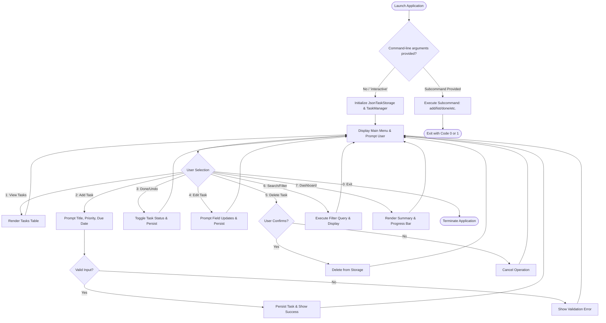

# Python CLI To-Do List Manager

A production-grade, modular, and self-contained Command Line Interface (CLI) To-Do List Application built in Python. Designed following Object-Oriented Programming (OOP) principles, clean layered architecture, and strict input validation.

---

## Table of Contents
1. [Project Overview](#project-overview)
2. [Key Features](#key-features)
3. [Architecture & System Design](#architecture--system-design)
   - [Layered Architecture Diagram](#layered-architecture-diagram)
   - [Module & Class Hierarchy](#module--class-hierarchy)
   - [Application Flow Diagram](#application-flow-diagram)
   - [Pseudo-Code of Core Workflows](#pseudo-code-of-core-workflows)
4. [Design Decisions & OOP Principles](#design-decisions--oop-principles)
5. [Prerequisites & Installation](#prerequisites--installation)
6. [How to Run the Application](#how-to-run-the-application)
   - [Interactive Menu Mode (REPL)](#1-interactive-menu-mode-repl)
   - [Direct CLI Subcommands (Scriptable)](#2-direct-cli-subcommands-scriptable)
7. [Error Handling & Input Validation](#error-handling--input-validation)
8. [Testing Guide](#testing-guide)
   - [Automated Unit Test Suite](#automated-unit-tests)
   - [Manual Testing Scenarios Checklist](#manual-testing-scenarios)
9. [Project Directory Layout](#project-directory-layout)

---

## Project Overview

The **To-Do List Manager** is a terminal application developed for the **Week 1 Task - Python CLI Application Design and Implementation**. It provides users with both an intuitive interactive menu (ideal for interactive daily use) and a set of command-line subcommands (ideal for shell scripts, aliases, and terminal power users).

### Highlights
- **Zero External Dependencies**: Built 100% on Python's Standard Library (`argparse`, `dataclasses`, `json`, `datetime`, `enum`, `abc`, `unittest`). Runs out of the box on standard Python 3.8+.
- **Dual Interface Modes**:
  1. *Interactive REPL Mode*: Full interactive menu loop with confirmation prompts and input guidance.
  2. *Command-Line Mode*: Direct UNIX-style subcommands (`todo add`, `todo list`, `todo done`, `todo stats`, etc.).
- **Atomic File Persistence**: Storage uses a temporary-file-and-atomic-rename pattern to prevent data corruption during power interruptions or abrupt shutdowns.
- **Cross-Platform Aesthetic UI**: Automatic ANSI color detection with fallback for non-TTY streams and automatic fallback for Unicode symbols on legacy Windows encodings (`cp1252`, `cp437`).

---

## Key Features

- **Task Management (CRUD)**:
  - Add tasks with title, optional description, priority, due date, and category tags.
  - Mark tasks as completed or revert them to pending.
  - Update any attribute of an existing task.
  - Delete individual tasks with confirmation safety prompts.
  - Batch clear all completed tasks.
- **Search, Filter & Sort**:
  - Filter tasks by status (`all`, `pending`, `completed`).
  - Filter by priority (`Low`, `Medium`, `High`, `Critical`).
  - Filter by category tag.
  - Case-insensitive keyword search in task titles and descriptions.
  - Sort by ID, Due Date, Priority Rank, Title, or Created Date (ascending/descending).
- **Productivity Dashboard**:
  - Visual completion progress bar (`[██████████░░░░░░] 60.0%`).
  - Aggregate statistics: Total tasks, Completed, Pending, Overdue count.
  - Breakdown counts by priority level and category.
- **Overdue Task Tracking**:
  - Automatic calculation of overdue status comparing due date against system date.

---

## Architecture & System Design

The application follows a **Separation of Concerns (SoC)** layered architecture where UI, business logic, storage, and models are isolated behind strict boundaries.

### Layered Architecture Diagram

```mermaid
graph TD
    User([User / Terminal]) --> CLI[CLI Entry Point: main.py / todo_cli.cli]
    
    subgraph UI_Layer [Presentation Layer]
        CLI --> Interactive[interactive.py: REPL Menu Loop]
        CLI --> Formatter[formatter.py: Table & Card Renderer]
        Formatter --> Colors[colors.py: ANSI Terminal Styler]
    end

    subgraph Service_Layer [Service Layer]
        Interactive --> TaskManager[task_manager.py: TaskManager Service]
        CLI --> TaskManager
    end

    subgraph Storage_Layer [Storage Abstraction Layer]
        TaskManager --> TaskStorage[storage/base.py: TaskStorage ABC]
        TaskStorage <|-- JsonStorage[json_storage.py: JsonTaskStorage]
        TaskStorage <|-- MemoryStorage[memory_storage.py: MemoryTaskStorage]
        JsonStorage --> Disk[(tasks.json on Disk)]
    end

    subgraph Domain_Layer [Domain Model Layer]
        TaskManager --> Task[models/task.py: Task Entity]
        Task --> Priority[models/priority.py: Priority Enum]
        TaskManager --> Validators[utils/validators.py: Input Validators]
        TaskManager --> Exceptions[utils/exceptions.py: Custom Exceptions]
    end
```

### Module & Class Hierarchy

| Module | Primary Classes / Functions | Responsibility |
| :--- | :--- | :--- |
| `todo_cli.models.priority` | `Priority(Enum)` | Defines priority levels (`Low`, `Medium`, `High`, `Critical`), ranking for sorting, and case-insensitive string parsing. |
| `todo_cli.models.task` | `Task(dataclass)` | Represents a task entity with attributes, status toggling, overdue detection, and JSON serialization/deserialization. |
| `todo_cli.storage.base` | `TaskStorage(ABC)` | Abstract interface specifying `load_all()` and `save_all()`. |
| `todo_cli.storage.json_storage` | `JsonTaskStorage` | Implements persistent storage to a JSON file on disk using atomic writes and corrupt file recovery. |
| `todo_cli.storage.memory_storage` | `MemoryTaskStorage` | In-memory implementation used for fast, isolated unit testing without touching disk. |
| `todo_cli.services.task_manager` | `TaskManager` | Business logic service: CRUD operations, filtering, sorting, unique ID generation, and dashboard metrics. |
| `todo_cli.utils.validators` | `validate_title`, `validate_date`, `validate_category`, `validate_task_id` | Input sanitization, calendar validity checking (`YYYY-MM-DD`), and constraint enforcement. |
| `todo_cli.utils.exceptions` | `TodoAppError`, `TaskNotFoundError`, `ValidationError`, `StorageError`, etc. | Custom domain exception hierarchy. |
| `todo_cli.ui.colors` | `paint`, `Style`, `success`, `error`, `warning`, `info` | Terminal color styling with automatic detection of ANSI support and `NO_COLOR` flag. |
| `todo_cli.ui.formatter` | `render_task_table`, `render_task_card`, `render_statistics_dashboard` | ASCII/Unicode table formatting, dynamic column sizing, progress bar rendering, and Windows character fallbacks. |
| `todo_cli.ui.interactive` | `run_interactive_menu` | Interactive REPL menu loop with input prompts and error trapping. |
| `todo_cli.cli` | `main`, `build_parser` | Subcommand parsing (`argparse`) and CLI orchestration. |

### Application Flow Diagram



### Pseudo-Code of Core Workflows

#### 1. Adding a Task
```text
FUNCTION add_task(title, description, priority, due_date, category):
    sanitized_title = validate_title(title)
    sanitized_date = validate_date(due_date)      # Must match YYYY-MM-DD
    sanitized_priority = parse_priority(priority) # Low, Medium, High, Critical
    sanitized_category = validate_category(category)

    new_id = (MAX of existing task IDs) + 1
    new_task = Task(id=new_id, title=sanitized_title, ...)
    
    tasks_map[new_id] = new_task
    storage.save_all(tasks_map.values()) # Atomic write to disk
    RETURN new_task
END FUNCTION
```

#### 2. Atomic File Persistence Pattern
```text
FUNCTION save_all(tasks):
    temp_file = ".tasks.json.tmp"
    target_file = "tasks.json"
    
    serialized_data = serialize_to_json(tasks)
    WRITE serialized_data TO temp_file
    FLUSH AND FSYNC temp_file TO DISK
    
    ATOMIC_REPLACE(temp_file, target_file) # Replaces destination atomically
END FUNCTION
```

---

## Design Decisions & OOP Principles

1. **Single Responsibility Principle (SRP)**:
   - Data validation is separated into `validators.py`.
   - UI formatting is isolated in `formatter.py` and `colors.py`.
   - Persistence logic is encapsulated in `json_storage.py`.
   - Business rules live in `task_manager.py`.
2. **Dependency Inversion Principle (DIP)**:
   - `TaskManager` depends on the `TaskStorage` abstract interface, not a concrete file class. This allowed writing a mock `MemoryTaskStorage` that runs 33 unit tests in milliseconds without touching disk or leaving residual files.
3. **Encapsulation & Domain Models**:
   - The `Task` class encapsulates its own completion state, completion timestamp, and overdue calculations (`task.is_overdue()`).
4. **Data Integrity (Atomic Writes)**:
   - Directly overwriting a file with `open("tasks.json", "w")` can corrupt the file if the process crashes midway. Writing to `.tasks.json.tmp` and using `os.replace` guarantees all-or-nothing file updates.
5. **Robust Error Recovery**:
   - If someone accidentally corrupts `tasks.json` by manual edits, the storage class creates a timestamped backup copy (`tasks.json.corrupted_<timestamp>`) to prevent data loss before raising a descriptive `StorageError`.
6. **Adaptive Terminal Compatibility**:
   - The terminal formatter detects console encoding. If Unicode characters (`✓`, `┌`, `─`) are not supported by the environment (e.g., Windows `cp1252`), it automatically substitutes ASCII-safe characters (`[v]`, `+`, `-`), preventing `UnicodeEncodeError`.

---

## Prerequisites & Installation

### Requirements
- **Python**: Version **3.8 or higher** (Tested on Python 3.10, 3.11, 3.12, 3.14).
- **Operating System**: Windows, macOS, or Linux.
- **External Dependencies**: None. Uses only standard library modules.

### Setup
Clone or extract the archive into any directory:
```bash
# Check your Python version
python --version
```

---

## How to Run the Application

The application can be run using either `python main.py` or as a module `python -m todo_cli`.

### 1. Interactive Menu Mode (REPL)
To launch the interactive menu, simply run without arguments:
```bash
python main.py
```
*(Or explicitly: `python main.py interactive`)*

You will be greeted with the main menu:
```text
  MAIN MENU
  ─────────────────────────
  1. View All Tasks
  2. View Pending Tasks
  3. View Completed Tasks
  4. Add New Task
  5. Mark Task as Done / Undo
  6. View Task Details
  7. Edit Task
  8. Delete Task
  9. Search & Filter Tasks
  s. Dashboard & Statistics
  c. Clear All Completed Tasks
  0. Exit
  ─────────────────────────
```

### 2. Direct CLI Subcommands (Scriptable)

For quick tasks or scripting, run subcommands directly from your terminal:

#### ➕ Add a Task
```bash
# Basic task
python main.py add "Buy milk"

# Task with priority, due date, category, and description
python main.py add "Submit Project" -p critical --due 2026-10-15 -c Academics -d "Submit ZIP archive and README"
```

#### 📋 List Tasks
```bash
# List all tasks
python main.py list

# List pending tasks sorted by due date
python main.py list --status pending --sort due_date

# Filter by priority or category
python main.py list -p high -c Work

# Search for a keyword in titles or descriptions
python main.py list -s "Project"
```

#### ✅ Complete or Reopen a Task
```bash
# Mark Task #1 as completed
python main.py done 1

# Revert Task #1 back to pending
python main.py undo 1
```

#### 🔍 View Task Details
```bash
python main.py view 1
```

#### ✏️ Edit an Existing Task
```bash
# Change priority and update due date
python main.py edit 1 -p high --due 2026-10-25

# Clear/remove an existing due date
python main.py edit 1 --clear-due
```

#### 🗑️ Delete a Task
```bash
# With confirmation prompt
python main.py delete 1

# Bypass confirmation prompt (useful in scripts)
python main.py delete 1 --force
```

#### 📊 Dashboard & Metrics
```bash
python main.py stats
```

#### 🧹 Clear Completed Tasks
```bash
python main.py clear-completed --force
```

#### ⚙️ Custom Storage File & Colors
```bash
# Store tasks in a custom file
python main.py --file my_tasks.json list

# Disable colored output (e.g. when piping to files)
python main.py --no-color list
```

---

## Error Handling & Input Validation

The application defends against unexpected inputs at every layer:

| Input / Condition | Validation Rule | Behavior / Error Message |
| :--- | :--- | :--- |
| **Empty Task Title** | Must not be empty or whitespace only. | `Validation Error: Task title cannot be empty or only whitespace.` |
| **Title Length** | Max 200 characters. | `Validation Error: Task title exceeds maximum allowed length of 200 characters.` |
| **Invalid Due Date** | Must follow `YYYY-MM-DD` and be a valid calendar date. | `Invalid date '2026-02-30': Date must match YYYY-MM-DD format and represent a real calendar day.` |
| **Invalid Priority** | Must match: `low`, `medium`, `high`, `critical` (or aliases `l`, `m`, `h`, `c`, `urgent`). | `Invalid priority 'urgent_now'. Allowed values are: 'Low', 'Medium', 'High', 'Critical'.` |
| **Missing Task ID** | ID must refer to an existing task. | `Task with ID 99 was not found.` |
| **Corrupted Storage File** | File contains invalid JSON syntax. | Automatically creates backup `tasks.json.corrupted_<timestamp>` and alerts user. |
| **Ctrl+C / Interrupt** | Handled cleanly in interactive mode. | Gracefully displays `Operation cancelled by user.` without crash traces. |

---

## Testing Guide

### Automated Unit Tests
The project includes a full unit test suite with **33 automated tests** covering models, validation, atomic storage, error recovery, business logic, and CLI commands.

To execute all tests with detailed verbosity:
```bash
python -m unittest discover -s tests -p "test_*.py" -v
```

Expected output:
```text
Ran 33 tests in 0.36s
OK
```

### Manual Testing Scenarios

Use this checklist to manually test and evaluate the application:

| Test Scenario | Steps | Expected Outcome |
| :--- | :--- | :--- |
| **1. Create Basic Task** | Run `python main.py add "Read Python Documentation"` | Success message displayed; task ID #1 assigned. |
| **2. Create Detailed Task** | Run `python main.py add "Submit Report" -p critical --due 2026-12-31 -c Work -d "Include diagrams"` | Task created with Critical badge and Work category. |
| **3. Input Validation** | Run `python main.py add "   "` (empty title) | Graceful error: `Task title cannot be empty`. |
| **4. Date Validation** | Run `python main.py add "Task" --due "2026-13-45"` | Graceful error explaining expected `YYYY-MM-DD` format. |
| **5. View Table** | Run `python main.py list` | ASCII/Unicode table displays both tasks with status and priority badges. |
| **6. View Task Card** | Run `python main.py view 2` | Detailed card with all metadata, created date, and description box. |
| **7. Mark Task Complete** | Run `python main.py done 2` | Status updates to `[✓] Completed`, completion timestamp recorded. |
| **8. Filter by Status** | Run `python main.py list --status pending` | Only Task #1 is displayed. |
| **9. Metrics Dashboard** | Run `python main.py stats` | Shows progress bar at 50%, 1 completed, 1 pending, and breakdown. |
| **10. Edit Task** | Run `python main.py edit 1 -t "Read Advanced Python Guide" -p high` | Title and priority updated in storage. |
| **11. Interactive Mode** | Run `python main.py`, select option `4` to add task, enter `cancel` | Creation safely aborted, returns to menu without crash. |
| **12. Deletion Safety** | Run `python main.py delete 1`, type `n` | Confirmation prevents accidental deletion. |
| **13. Persistence Check** | Exit the app and reopen it with `python main.py list` | All tasks remain intact in `tasks.json`. |

---

## Project Directory Layout

```text
Antigravity/
├── todo_cli/                     # Main Application Package
│   ├── __init__.py               # Package metadata and version
│   ├── __main__.py               # python -m todo_cli entry point
│   ├── cli.py                    # CLI command parser and dispatch logic
│   ├── models/                   # Domain Model Layer
│   │   ├── __init__.py
│   │   ├── task.py               # Task dataclass with state & serialization
│   │   └── priority.py           # Priority enum with ranking & aliases
│   ├── storage/                  # Storage Abstraction Layer
│   │   ├── __init__.py
│   │   ├── base.py               # TaskStorage abstract base class (DIP)
│   │   ├── json_storage.py       # Atomic JSON disk persistence & recovery
│   │   └── memory_storage.py     # In-memory storage for unit testing
│   ├── services/                 # Business Logic Layer
│   │   ├── __init__.py
│   │   └── task_manager.py       # TaskManager CRUD, filtering, sorting, stats
│   ├── ui/                       # Presentation Layer
│   │   ├── __init__.py
│   │   ├── colors.py             # ANSI color styling & terminal detection
│   │   ├── formatter.py          # Table layouts, cards, progress bars
│   │   └── interactive.py        # Interactive REPL menu loop
│   └── utils/                    # Common Utilities Layer
│       ├── __init__.py
│       ├── exceptions.py         # Custom application exception hierarchy
│       └── validators.py         # Title, date, category, ID validators
├── tests/                        # Comprehensive Unit Test Suite
│   ├── __init__.py
│   ├── test_models.py            # Model & validation unit tests
│   ├── test_storage.py           # Storage & atomic write unit tests
│   ├── test_manager.py           # Service CRUD & filtering tests
│   └── test_cli.py               # Command-line interface tests
├── main.py                       # Root executable entry point
├── requirements.txt              # Standard library declaration
└── README.md                     # Comprehensive project documentation
```

---

## Submission Notes
- This submission is fully self-contained and ready to execute in any standard Python environment without installing third-party packages.
- All code files contain clear docstrings and inline comments explaining software design decisions.
